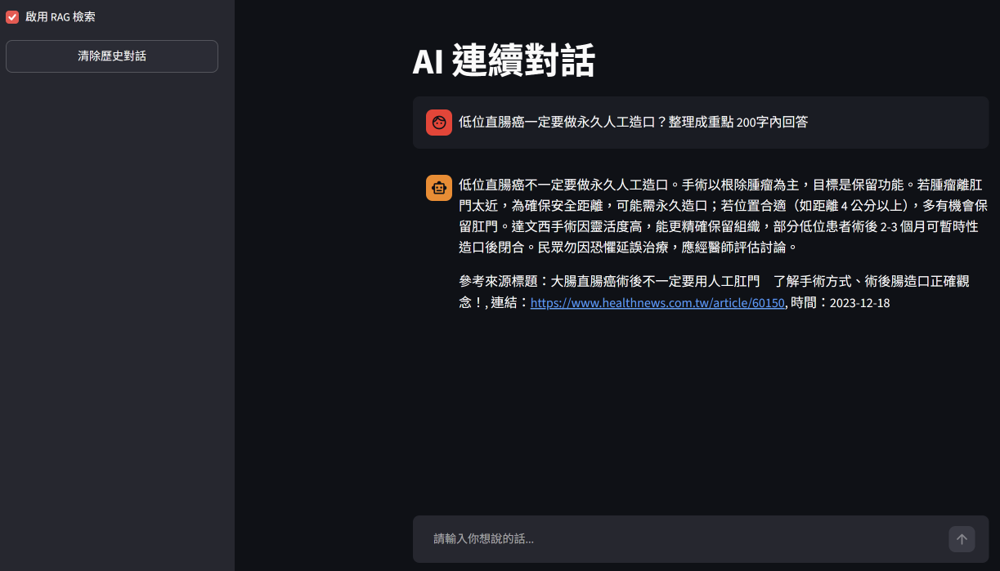
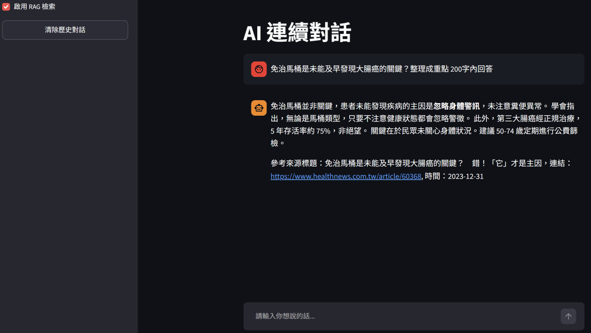

# 透過 RAG 建立健康諮詢小幫手

## RAG 資料來源

- [健康醫療網](https://www.healthnews.com.tw/)

## 模型

### 對話模型

- [unsloth/Qwen3.5-4B-GGUF](https://huggingface.co/unsloth/Qwen3.5-4B-GGUF)

### Embedding 模型

- [BAAI/bge-m3](https://huggingface.co/BAAI/bge-m3)

## 安裝套件

### 系統環境

- Windows 11 + WSL2 Ubuntu 26.04 LTS

### python 版本

- CPython 3.12.10

### GPU 類型

- Intel ARC 140V

### llama.cpp 版本

- b11642

### 透過 UV 安裝

```bash
uv venv --python 3.12.10
uv pip install -r requirements.txt
```

### Intel GPU 如何安裝 pytorch 可以參考我的 repo

[wsl2-docker-intel-gpu-pytorch-setup](https://github.com/jim-yc/wsl2-docker-intel-gpu-pytorch-setup)

## 說明

**本專案有以下步驟：**

1. 爬取健康醫療網資料，使用 `unsloth/Qwen3.5-4B-GGUF` 模型對於新聞全文進行摘要。
2. 使用 `BAAI/bge-m3` 預訓練模型產生新聞摘要 embedding，存到 Qdrant 向量資料庫。
3. 對於使用者的問題用 `BAAI/bge-m3` 預訓練模型產生 embedding，到 Qdrant 向量資料庫進行餘弦相似度檢索。
4. 將檢索到的原文注入到 `unsloth/Qwen3.5-4B-GGUF` 模型回答使用者問題。

## 執行方法

### 檔案結構

```
├── db_20261027        # Qdrant 資料庫資料
├── crawl_data.py      # 爬蟲程式
├── build_db.py        # 建立資料庫
├── rag.py             # RAG 核心運算
├── app.py             # 問答介面
├── news_data_all.json # 原始資料
├── requirements.txt   # 套件列表
├── .gitignore         # Git 忽略清單
└── README.md          # 專案說明文件
```

### 準備資料

先準備 GGUF 模型，然後開啟 llama-server.exe，llama.cpp 如何使用可以參考：

- [ggml-org/llama.cpp](https://github.com/ggml-org/llama.cpp)

開啟時要先確定埠號是 9931

```bash
--port 9931
```

然後執行

```bash
uv run -p 3.12.10 python crawl_data.py
```

### 建立資料庫

```bash
uv run -p 3.12.10 python build_db.py
```

### 開啟對話

經由 `streamlit` 開啟

```bash
uv run streamlit run app.py
```

## 成果

### 問答一



### 問答二

